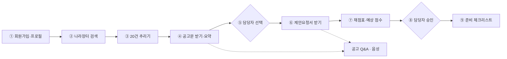
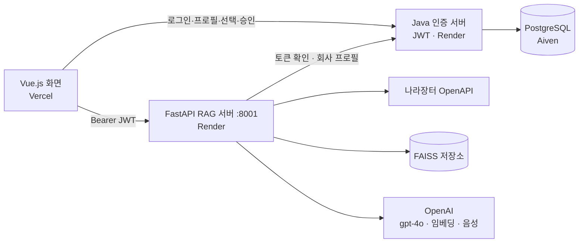

# 나라장터 입찰공고 맞춤 Q&A 서비스

> 회사 프로필에 맞는 공공 입찰 공고를 찾아 요약하고, 채점표 기준 예상 점수와 준비 체크리스트를 **공고문 출처(파일명 p.쪽)와 함께** 보여 주는 External RAG 서비스

- **서비스:** <https://ai-mini-project-six.vercel.app>
- **RAG API 문서(Swagger):** <https://ai-mini-datapipeline.onrender.com/docs> · 인증 서버 상태: <https://ai-service-mini-backend.onrender.com/api/health>

---

## 1. 왜 필요한가

중소기업 입찰 담당자는 매주 나라장터에서 공고를 찾고, 공고문·제안요청서를 내려받아 참가자격·채점표·제출서류를 엑셀로 정리해 "이 공고에 들어갈지" 보고합니다.

| 불편 | 지금 방식 |
|---|---|
| 공고 고르기 | 키워드 검색 결과를 하나씩 열어 우리 회사와 맞는지 판단 |
| 자격·서류 확인 | 참가자격·제출서류·평가방식이 첨부파일 여러 개에 흩어져 있음 |
| 점수 계산 | 채점표를 보고 우리 회사 점수를 손으로 계산 |

키워드 검색은 "참가자격이 뭐야?" 같은 질문에 답하지 못합니다. 평가셋에서 **RAG 정답률 22/22, 키워드 검색 14/22**로 차이를 확인했습니다([평가](#7-평가-결과)).

## 2. 무엇을 하나

**목적:** 공고를 고르고 자격을 확인하는 시간을 줄이고, 모든 답에 출처를 달아 담당자가 바로 검증할 수 있게 합니다.

| 기능 | 내용 |
|---|---|
| 회사 프로필 | 업종 · 지역 · 규모 · 면허 · 실적 · 보유 서류 · 희망 금액 저장 |
| 검색 · 20건 추리기 | 기간 · 검색어로 나라장터 API 실시간 검색 → 금액 · 마감 · 지역 제한으로 거르고 공고명 유사도로 순위 |
| 공고문 요약 | 20건의 공고문만 받아 사업명 · 예산 · 기간 · 자격 · 일정 · 평가비율 요약 (항목마다 출처) |
| 채점표 · 예상 점수 | 고른 공고만 제안요청서까지 받아 채점표 정리. 원문 산정표가 있는 정량 항목만 코드로 계산 |
| 준비 체크리스트 | 승인한 공고(여러 건)의 제출서류 · 일정(D-day), 보유 서류는 자동 체크 |
| 공고 Q&A | 질문 → 출처가 달린 답. 문서에 없으면 지어내지 않고 담당자에게 넘김(handoff) |
| 확장 X2 · 채점 에이전트 | Tool Calling으로 항목마다 계산 / 담당자 판단을 고르고, 프로필이 부족하면 되물음 |
| 확장 X3 · 음성 질의 | 마이크 → 받아쓰기(STT) → Q&A → 음성 답변(TTS) |

**AI의 역할은 보조입니다.** 자격 관련 답은 `needs_review`로 표시하고, 선택 · 승인은 담당자가 합니다. 낙찰 확률 · 정성 평가 점수 · 총점은 보여 주지 않습니다(총점은 낙찰 가능성으로 오해되기 쉬움).

## 3. 동작 과정



- ③은 공고문을 받기 **전**이라 목록 정보(금액 · 마감 · 지역)와 공고명으로만 추립니다. ④ 이후 공고문 본문으로 부적격을 다시 확인합니다.
- ⑥은 다시 검색하지 않고 ②에서 저장한 링크를 쓰며, 그 공고의 정정 차수만 다시 확인합니다.
- 제안요청서가 없으면 채점표를 만들지 않습니다(409). 빈 채점표로 점수를 추정하지 않기 위해서입니다.

## 4. 아키텍처



| 계층 | 폴더 | 역할 |
|---|---|---|
| 화면 | `frontend/` | Vue 3 + Vite. 검색 → 요약 → 선택 → 채점 → 승인 → 체크리스트 · Q&A 화면 |
| 인증 · 백엔드 | `workplace/` | Java. 회원가입 · 로그인(JWT), 회사 프로필 · 요약 · 선택 · 승인 저장 |
| 데이터 파이프라인 | `data_pipeline/` | 나라장터 검색, 공고문 · 첨부 다운로드, HWP→PDF 변환, 개인정보 마스킹, FAISS 적재 |
| RAG · 추출 | `rag-code-template_ext/` | Q&A, 요약, 채점표 · 서류 추출, 음성, 1 · 3 · 4번 연결 |
| 추리기 · 점수 | `rag-code-template_ext/bid_logic/` | 20건 추리기, 정량 점수 계산, 체크리스트, 채점 에이전트 |

**인증 흐름:** Java 서버가 JWT를 발급하고, RAG 서버는 비밀키를 갖지 않고 받은 토큰을 Java 서버(`/api/auth/check`, `/api/profile`)에 넘겨 확인합니다. `/health`를 뺀 모든 RAG API는 토큰이 없거나 만료되면 401입니다.

## 5. 모델

같은 평가셋으로 대안 모델과 비교해 골랐습니다 → [`eval/MODEL_COMPARISON.md`](rag-code-template_ext/eval/MODEL_COMPARISON.md)

| 용도 | 모델 | 고른 이유 |
|---|---|---|
| Q&A · 요약 · 채점표 추출 | **gpt-4o** | gpt-4.1-mini는 6배 싸지만 문서에 없는 "예상 낙찰가"를 지어냄(환각 1/7). 속도 차이는 0.1초 |
| 문서 · 질문 임베딩 | **text-embedding-3-small** | 근거 쪽 인용 49/49로 검색 누락 없음 |
| 받아쓰기 (STT) | **gpt-4o-mini-transcribe** | whisper-1보다 정확(글자 오류 6.5% vs 9.7%)하고 빠름. "제안서"를 "제한서"로 틀리지 않음 |
| 읽어 주기 (TTS) | **tts-1** | gpt-4o-mini-tts와 정확도가 같고 1초 빠름 |
| 채점 에이전트 (X2) | **gpt-4o** | 고정 경로와 정확도 · 시간 · 비용을 비교 측정 |

**환각을 막는 장치:** 답을 찾았는지(`found`) · 인용 문서를 별도 칸으로 받아 못 찾으면 handoff, 추정 문장은 코드로 삭제, AI가 고른 출처는 코드가 원문과 대조(`source_verified`), 금액 · 날짜는 원문 그대로.

## 6. 데이터

| 데이터 | 출처 | 처리 |
|---|---|---|
| 공고 목록 | 조달청 나라장터 입찰공고정보서비스(공공데이터포털 OpenAPI), 용역 공고 | 실시간 검색 |
| 공고문 · 제안요청서 | 위 검색 결과의 첨부 | HWP → PDF 변환(LibreOffice + H2Orestart), 쪽 단위 1,000자 청크(중첩 200) |
| 웹 자료 5개 | 협상에 의한 계약 제안서 평가 기준 · SW사업 제안요청서 작성 가이드 · 용역 적격심사 기준 · 공동수급 표준협정서 · 나라장터 입찰참가자격 등록 (공식 문서 URL) | 같은 저장소에 적재 |

- 청크마다 공고번호 · 차수 · 파일명 · 쪽 · 수집일을 남겨, 정정공고가 올라와도 어느 차수의 답인지 구분합니다.
- **개인정보:** 사람 이름 · 식별번호는 적재 전 마스킹하고, API의 담당자 성명 · 연락처 필드는 화면에 내보내지 않습니다. 회사 프로필에는 개인정보를 받지 않습니다.

## 7. 평가 결과

교재 기준(정확성 · 근거성 · 환각)으로 재고, 한 번에 하나만 바꾸고 같은 평가셋으로 다시 쟀습니다.

**공고 Q&A** — 질문–기대답변 56문항(테스트 공고 26 + 처음 보는 실제 공고 3건 30, 문서에 없는 예외 7개 포함)

| 단계 | 바꾼 것 | 정확 (테스트 공고) |
|---|---|---|
| 키워드 검색 베이스라인 | — | 14/22 |
| 개선 전 RAG | — | 16/22 |
| ① | 검색 조각 수 top_k 5 → 10 | 20/22 |
| ② | 질문 단어 키워드 보강 | **22/22** |
| ③ | 비율형 답 판단 · 띄어 쓴 글자 붙이기 · 내부 번호 제거 | 22/22 유지, 실제 공고 **27/27** |

최종: **정확 49/49 · 근거성(기대 쪽 인용) 49/49 · 예외 처리 7/7 · 환각 0/7**. 위험 문항 10개 × 5회 반복 50/50. 결과 파일: `rag-code-template_ext/eval/results/`

**추리기 · 점수 · 에이전트** — [`evaluation/real/REPORT.md`](rag-code-template_ext/evaluation/real/REPORT.md)

| 항목 | 결과 |
|---|---|
| 20건 추리기 (가상 회사 3곳, P@5) | 목록 단계 40 · 80 · 60%, 본문 재확인 40 · 100 · 60% (관련 공고가 2 · 5 · 3건이라 최대치 40 · 100 · 60%) |
| 예상 점수 (채점표 항목 일치) | 정량 12/12, 전체 264/264 |
| 채점 에이전트 X2 vs 고정 경로 | 정확도 같음(264/264), 요청당 약 7.5초 · $0.04 추가 → 이 사례에선 고정 경로가 효율적 |

추천 정답(공고 20건 × 회사 3곳 = 60개 판정)은 AI가 원문과 대조해 만들었고, 사람 검토는 진행 전입니다.

## 8. 실행 방법

**배포:** 화면 Vercel · 인증 서버와 RAG 서버 Render · DB Aiven. 위 [서비스 주소](#나라장터-입찰공고-맞춤-qa-서비스)에서 바로 쓸 수 있습니다.

**로컬:** 비밀값은 저장소에 없습니다. 예시 파일을 복사해 값을 채웁니다.

```bash
cp .env.example .env                       # Python(1·2·3번): OPENAI_API_KEY, DATA_GO_KR_SERVICE_KEY, BACKEND_URL
cp workplace/.env.example workplace/.env   # Java(4번): DB_*, JWT_SECRET, SERVER_PORT

# 1) 인증 서버 + DB (Docker Compose)
cd workplace && docker compose up -d --build
# 2) RAG 서버
cd rag-code-template_ext && pip install -r requirements-e.txt -r ../data_pipeline/requirements.txt
python -m uvicorn rag_external-web_pdf_closed_llm:app --port 8001
# 3) 화면
cd frontend && npm install && AUTH_BACKEND=http://localhost:8080 VITE_USE_MOCK=false npm run dev   # http://localhost:5174
```

- `BACKEND_URL`(RAG) · `SERVER_PORT`(Java) · `AUTH_BACKEND`(화면)은 같은 포트여야 합니다.
- HWP 변환 도구 설치: `bash data_pipeline/setup_environment.sh`
- 평가 재실행: `python rag-code-template_ext/eval/run_eval.py --token <토큰>`
- 파트별 상세: [데이터](data_pipeline/README.md) · [RAG](rag-code-template_ext/RUN.md) · [추리기 · 점수](rag-code-template_ext/bid_logic/README.md) · [백엔드](workplace/README_BACKEND.md)

## 9. 한계와 다음 단계

- **용역 공고만 검색합니다.** 물품(납품) · 공사 공고는 다음 단계입니다.
- Render 무료 서버는 재배포하면 받아 둔 공고 · 요약이 사라집니다. 영구 저장소로 옮겨야 합니다.
- 검색은 후보 공고마다 상세 조회를 차례로 해서 느립니다. 동시 처리로 줄일 수 있습니다(결과 동일성 비교 테스트 필요).
- 스캔 PDF는 OCR을 하지 않습니다.
- 낙찰 확률 · 정성 평가 점수 · 총점은 일부러 제공하지 않습니다.

## 10. 팀

| # | 담당 | 이름 | 주요 산출물 |
|---|---|---|---|
| 1 | 데이터 파이프라인 | 안영준 | 나라장터 검색 · 적재 API, HWP 변환, 마스킹, FAISS 인덱스, Render 배포 |
| 2 | RAG · 요약 · Q&A | 손경락 | Q&A · 요약 · 채점표 · 서류 추출, 1 · 3 · 4번 연결, 평가셋 · 개선 기록, 모델 비교, 음성 질의(X3) |
| 3 | 추리기 · 점수 · 체크리스트 | 정하윤 | 20건 추리기, 정량 점수 계산, 체크리스트, 채점 에이전트(X2), 추천 · 점수 평가 |
| 4 | 인증 · 백엔드 API · 운영 | 손수경 | JWT 인증, 프로필 · 요약 · 선택 · 승인 API, PostgreSQL, 배포 설정 |
| 5 | 프론트엔드 · 발표 | 신한수 | 전체 화면(검색 → 체크리스트 · Q&A · 음성), 배포, 발표 자료 |
